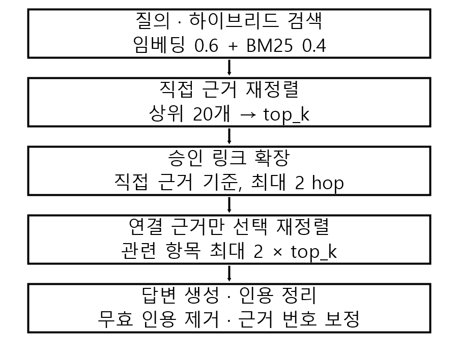

# 사람 승인 교차문서 링크를 이용한 철도 규정 근거 검색 향상

*Improving Evidence Retrieval for Railway Regulation QA with Human-Approved Cross-Document Links*

## 요약

철도 규정 질의는 현장 길라잡이의 구체 절차와 규정의 보고·운전 조건을 함께 요구할 수 있다. 
본 연구는 관리자가 연결한 문서 구간 링크를 검색 확장 경계로 평가하고, 연결 근거 선택 재정렬은 부차 분석으로 둔다. 
link_all−hybrid_rerank_k3의 그래프 Recall 차이는 개발 사례에서 +0.128, 신규 사례에서 +0.267이며 군집 구간으로 기술한다. 
정답 라벨은 철도 운영기관 현업 전문가 1인의 체크리스트 검수를 거쳤지만, 신규 표본은 링크 구성에 조건부이므로 탐색적으로 해석한다.

## 1. 서론 및 관련 연구

기관사와 관제원이 설비 고장 대응을 확인할 때는 길라잡이의 구체 조치와 규정의 보고·운전 조건을 함께 찾아야 한다. 본 연구의 범위는 오프라인 근거 확인·검토 지원이며, 운전 지시를 제공하거나 대체하지 않는다.

검색 증강 생성은 외부 근거를 답변에 연결하고[1], LLM 재정렬은 검색 후보의 질의 관련 순서를 조정한다[2]. GraphRAG와 LightRAG는 문서에서 관계 그래프를 구성하며[3,4], KG²RAG는 검색 seed에서 연결 문단을 확장한다[5]. 철도 QA의 CARAG는 공간·사례 그래프를 탐색하고, 도시철도 출입문 RAG는 고장 이력과 재정렬을 이용한다[6,7]. LegalBench-RAG는 전문가 근거 주석을 제공하고, 한국어 법률 RAG는 검색 조합을 최적화한다[8,9]. 답변 지표는 RAGAS로 계산한다[10]. 본 연구는 새 그래프 검색 알고리즘의 우월성을 주장하지 않는다. 평가 단위는 추출한 일반 관계가 아니라 관리자가 연결한 규정–길라잡이 문서 구간이며, 승인 링크 상태와 근거 위치를 운영 경계로 사용한다.

## 2. 방법

하이브리드 검색 상위 20개에서 LLM이 직접 근거를 최대 top_k=5개 고른 뒤, 직접 근거를 보존하고 승인 링크로 연결 구간을 확장한다. link_all은 전체 최종 근거를 최대 top_k×3개로 제한한다. proposed는 직접 근거를 모두 보존하고 연결 근거만 질문별 재정렬해 최대 top_k×2개 더한다. hybrid_rerank_k3는 선택 결과가 3개 미만이면 hybrid 순위에서 보충하는 예산 민감도 기준선이다. 이 opt-in 설정은 최대 top_k까지 최소 개수를 보장하며, 기본값은 기존 동작을 유지한다.

그림 1. 직접 근거를 보존하고 링크 경유 근거만 선택한다.

## 3. 평가 및 결과

평가셋 v3은 existing_v2 17건(문서형 12, 그래프형 5)과 llm_drafted 20건(문서형 5, 그래프형 15)으로 구성된다. llm_drafted 20건은 철도 운영기관 현업 전문가 1인이 질문 현실성, 정답 근거 정확성, 참조 답변 정확성, 링크 필요성을 다루는 체크리스트로 검토해 모두 OK 판정(수정·삭제 0건)을 받았다. 일곱 변형 모두 37건에서 검색을 세 번 실행했다. hybrid_rerank_k3는 r1만 답변·RAGAS 평가를 하고 r2–r3은 검색 평가만 했다. 따라서 검색 평균은 세 반복, 해당 변형의 답변 지표 및 matched 답변 비교는 r1 결과다. 생성·평가 judge는 gpt-5.6-luna, 검색·평가 임베딩은 각각 text-embedding-3-small, text-embedding-3-large였다. 평가 시점 승인 링크 스냅샷에는 36개 행이 있으며 해시는 paper/experiments/provenance.md에 기록했다. task brief의 37개와 한 개 차이가 있다.

표 1. 그래프 질의 검색 결과 (n=20). hybrid_rr=hybrid_rerank, hybrid_rr_k3=hybrid_rerank_k3. 값은 세 반복의 사례 평균 ± 반복 간 표본 표준편차다.

| 변형 | Recall | 링크 정답 Recall | 근거 수/질의 |
|---|---:|---:|---:|
| bm25 | 0.592 ± 0.000 | 0.275 ± 0.000 | 5.00 ± 0.00 |
| dense | 0.383 ± 0.000 | 0.000 ± 0.000 | 5.00 ± 0.00 |
| hybrid | 0.521 ± 0.000 | 0.150 ± 0.000 | 5.00 ± 0.00 |
| hybrid_rerank | 0.586 ± 0.019 | 0.233 ± 0.014 | 2.08 ± 0.06 |
| hybrid_rr_k3 | 0.618 ± 0.017 | 0.225 ± 0.043 | 3.15 ± 0.05 |
| link_all | 0.850 ± 0.014 | 0.750 ± 0.000 | 3.08 ± 0.03 |
| proposed | 0.839 ± 0.046 | 0.708 ± 0.063 | 3.00 ± 0.17 |

표 2. 출처별 paired 차이와 연결 정답 끝점 군집 bootstrap (10,000회). k3=hybrid_rerank_k3; 차이는 첫 변형 − 둘째 변형이며 CI는 기술적 민감도 구간이다.

| 출처 (사례/군집) | 비교 | ΔRecall [95% CI] | Δ링크 정답 Recall [95% CI] |
|---|---|---:|---:|
| existing_v2 (5/5) | link_all − k3 | +0.128 [+0.017, +0.244] | +0.367 [+0.067, +0.700] |
| existing_v2 (5/5) | proposed − k3 | +0.150 [+0.017, +0.283] | +0.400 [+0.100, +0.700] |
| existing_v2 (5/5) | proposed − link_all | +0.022 [+0.000, +0.067] | +0.033 [+0.000, +0.100] |
| llm_drafted (15/6) | link_all − k3 | +0.267 [+0.083, +0.440] | +0.578 [+0.271, +0.889] |
| llm_drafted (15/6) | proposed − k3 | +0.244 [+0.098, +0.400] | +0.511 [+0.246, +0.806] |
| llm_drafted (15/6) | proposed − link_all | −0.022 [−0.083, +0.026] | −0.067 [−0.167, 0.000] |

군집은 같은 via_link 정답 끝점(문서 버전, 조항)을 공유하는 사례의 연결요소로 묶었으며, link ID가 없어 끝점 공유를 대리 지표로 썼다. 5개 개발·6개 신규 군집은 작아 CI는 확증적 추론이 아니다. 신규 그래프 15건은 승인 링크와 양 끝 원문에서 초안되어 해당 링크에 조건부인 표본이다.

표 3. proposed − link_all의 출처별 문맥·답변·지연 차이 (CI는 링크 끝점 군집 bootstrap이며 탐색적이다).

| 출처 (사례/군집) | ΔContext Precision [95% CI] | ΔAnswer Correctness [95% CI] | Δ지연 (초/질의) [95% CI] |
|---|---:|---:|---:|
| existing_v2 (5/5) | +0.109 [+0.002, +0.220] | −0.003 [−0.040, +0.042] | +1.057 [+0.904, +1.211] |
| llm_drafted (15/6) | +0.025 [+0.008, +0.042] | −0.001 [−0.019, +0.018] | +0.343 [−0.761, +1.066] |

proposed−k3의 matched r1 RAGAS Δ는 기존 사례에서 Context Precision −0.266 [−0.478, −0.099], Answer Correctness −0.022 [−0.120, +0.077], 신규 사례에서 각각 +0.020 [−0.047, +0.078], +0.031 [−0.043, +0.136]이다. k3 답변 지표와 두 matched 차이는 r1만 있어 기술적으로 해석한다. 그래프 질의 평균 지연은 k3/link_all/proposed 순으로 1.446/2.157/2.678초다. 답변 생성과 RAGAS 채점은 같은 모델이며 블라인드 사람 평가는 없었다. 비용은 일관되게 기록되지 않아 비교하지 않았다.

## 4. 논의 및 결론

출처별 결과와 군집 구간은 개발 사례와 링크 구성 신규 사례를 나누어 해석해야 함을 보여준다. k3는 부족한 선택을 최소 3개까지 보충하지만 정확한 근거 수를 고정하지 않아, 이 비교는 예산 민감도 분석이지 토큰 예산 통제 실험은 아니다. 링크 구성에 유리한 표본을 배제하지 못하므로 현장 질의 전반에 일반화하지 않는다.

스냅샷은 Round 4 평가 시점 상태만 보존하며 과거 상태는 복원하지 못한다. 관리자는 링크 양 끝 구간을 선택하고 승인 상태·담당자·시각을 기록하지만, 의미상 승인 기준과 문서 개정·폐기 규칙은 확인되지 않았다. 승인 상태를 독립 품질 검증으로 해석해서는 안 된다.

이 결과는 승인 링크 기반 확장이 이 평가 사례에서 교차문서 근거 회수를 돕는다는 탐색적 근거다. 두 출처는 나누어 보고하지만 llm_drafted 사례는 링크에서 구성되어 독립 holdout이 아니므로 설계상 순환성은 남는다. 단일 평가자 검수로 평가자 간 일치도를 산출하지 않았고, 검수자는 링크 구조에 대해 블라인드되지 않았다. 연결 근거가 빠져도 시스템은 경고 없이 직접 근거만으로 답할 수 있으므로, 사람 검수와 안전성 검증 전에는 실제 운전 판단에 사용해서는 안 된다.

## 참고문헌

[1] P. Lewis, E. Perez, A. Piktus, F. Petroni, V. Karpukhin, N. Goyal, H. Küttler, M. Lewis, W. Yih, T. Rocktäschel, S. Riedel, and D. Kiela, “Retrieval-Augmented Generation for Knowledge-Intensive NLP Tasks,” *Advances in Neural Information Processing Systems*, vol. 33, pp. 9459–9474, 2020.

[2] W. Sun, L. Yan, X. Ma, S. Wang, P. Ren, Z. Chen, D. Yin, and Z. Ren, “Is ChatGPT Good at Search? Investigating Large Language Models as Re-Ranking Agents,” in *Proceedings of EMNLP 2023*, pp. 14918–14937, 2023.

[3] D. Edge, H. Trinh, N. Cheng, J. Bradley, A. Chao, A. Mody, S. Truitt, D. Metropolitansky, R. O. Ness, and J. Larson, “From Local to Global: A Graph RAG Approach to Query-Focused Summarization,” arXiv:2404.16130, 2024.

[4] Z. Guo, L. Xia, Y. Yu, T. Ao, and C. Huang, “LightRAG: Simple and Fast Retrieval-Augmented Generation,” in *Findings of EMNLP 2025*, pp. 10746–10761, 2025.

[5] X. Zhu, Y. Xie, Y. Liu, Y. Li, and W. Hu, “Knowledge Graph-Guided Retrieval Augmented Generation,” in *Proceedings of NAACL 2025: Human Language Technologies*, vol. 1, pp. 8912–8924, 2025.

[6] W. Zheng, M. Yang, Y. Ren, H. Wang, C. Zeng, and Y. Zhang, “CARAG: Context-Aware Retrieval-Augmented Generation for Railway Operation and Maintenance Question Answering over Spatial Knowledge Graph,” *ISPRS International Journal of Geo-Information*, vol. 15, no. 2, Article 78, 2026.

[7] L. Huang, Z. Liu, C. Yu, T. Zhu, and B. Yan, “Emergency Operation Scheme Generation for Urban Rail Transit Train Door Systems Using Retrieval-Augmented Large Language Models,” *Sensors*, vol. 26, no. 6, Article 2006, 2026.

[8] N. Pipitone and G. H. Alami, “LegalBench-RAG: A Benchmark for Retrieval-Augmented Generation in the Legal Domain,” arXiv:2408.10343, 2024.

[9] 서준원, 민정혜, “한국어 법률 QA를 위한 하이브리드 RAG 시스템 최적화,” *한국컴퓨터정보학회논문지*, 제30권, 제8호, pp. 53–63, 2025.

[10] S. Es, J. James, L. Espinosa Anke, and S. Schockaert, “RAGAs: Automated Evaluation of Retrieval Augmented Generation,” in *Proceedings of EACL 2024: System Demonstrations*, pp. 150–158, 2024.
